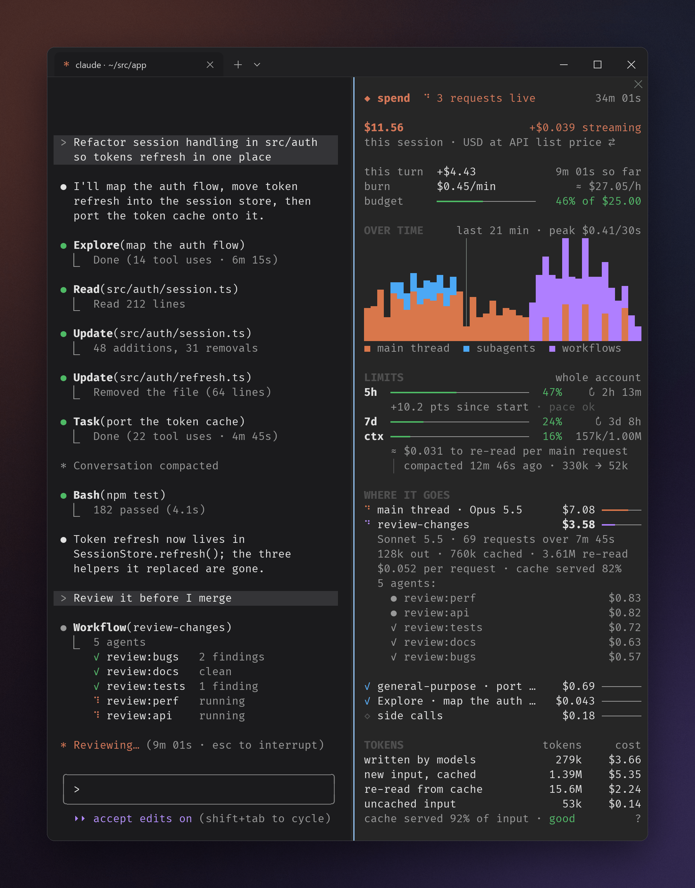

# spend-meter

[](https://github.com/Hekzory/spend-meter/actions/workflows/ci.yml)
[](LICENSE)

A live spend meter for [Claude Code](https://claude.com/claude-code). It docks at
the right of the terminal and shows what the session has cost so far, as it
happens: the main thread, every subagent and every workflow agent, the burn rate,
your subscription limits and where the money goes.



## Install

Type this at a Claude Code prompt in a terminal:

```
/plugin install spend-meter --marketplace Hekzory/spend-meter
```

Answer `y` to add the marketplace, then pick a scope; the user scope loads the meter
in every session. From a shell, the same is
`claude plugin marketplace add Hekzory/spend-meter && claude plugin install spend-meter@spend-meter`.

It needs Claude Code 2.1.296 or later; showing a subagent's transcript from its row
needs 2.1.300. The pane opens by itself in a wide terminal; `/spend` opens it at any width.

Claude Code updates plugins from marketplaces other than its own only when told to:
turn it on in `/plugin` → **Marketplaces** → **spend-meter** → **Enable auto-update**,
and each new version arrives when Claude Code starts. Otherwise,
`claude plugin update spend-meter@spend-meter` fetches it.

## Using it

| | |
| --- | --- |
| `/spend` | toggle the pane (it also works mid-turn) |
| `/spend budget 25` | alerts at 50 %, 80 % and 100 % of $25; `budget off` clears it |
| `/spend chip` | the one-line meter under the prompt while the pane is closed |
| `/spend unit` | what the big number counts |
| `/spend milestones on\|off` | the toasts at $1, π, $10, $42… |
| `/spend gfx auto\|cells\|pixels` | how the chart is drawn |
| `/spend rebuild` | read the session back from its transcripts again |

Press the line under the total to change what it counts. Press a row under
**where it goes** to see its model, requests, tokens, cache hit and, for a
workflow, its agents; a subagent's row can also put that agent's transcript in the
main view, and bring the main conversation back. Press the `?` by **cache served**
for what the cache saved.

## What it draws with

- **The chart** stacks what the main thread, subagents and workflows spent per
  30 seconds over the last ~20 minutes, in 24-bit block elements exact to an eighth
  of a cell; a `│` marks where the session compacted. Windows Terminal and kitty
  both draw block elements as geometry, so it comes out seamless.
- **kitty and Ghostty** also get the chart as an anti-aliased picture through the
  kitty graphics protocol, the one picture protocol Claude Code's `Image` speaks
  (no Sixel, no iTerm2). `/spend gfx cells|pixels|auto` overrides the choice.

## What the numbers are

- **History** is read back from the session's transcripts when the meter starts
  (the main thread's, `subagents/` and `subagents/workflows/`), every response priced
  exactly with its 5-minute and 1-hour cache writes split, so a meter that starts
  late or after `--resume` shows the whole session. `/spend rebuild` reads them again.
- **The big total** is the engine's own ledger, the figure `/cost` and the status
  line show: every priced response of the session, subagents, workflow agents and
  the engine's side calls (auto-mode classifier, titles, compaction) included. On a
  subscription it is what the session would cost at API list prices.
- **Where it goes** prices each response with Claude Code 2.1.300's own catalog
  (`hooks/pricing.ts`). The engine does not tell a mod which response cost what,
  so the rows are estimates; a row marked `≥` has a model the catalog lacks. Main-thread cache writes are priced at
  the 1-hour rate on a subscription and subagents' at the 5-minute rate, as the
  CLI requests them. **side calls** (the classifier, titles) is the rest of the total;
  **before the meter** is what the session had spent when the meter started.
- **Limits** are the account's 5-hour and 7-day windows from the last response.
  They are account-wide: other sessions move them too. `+N pts since start` is
  how far a window moved while this session ran; the pace line projects the last
  15 minutes forward and warns when the window would fill before it resets.
- **ctx** is the context window; "≈ $X to re-read per main request" is that
  context priced at the main model's cache-read rate, the floor of every request.
  A compaction is noted under it (and marked on the chart); nothing resets. `/clear`
  starts the meter over.
- **Tokens** are split by what is paid for: what the models wrote (output), new
  input stored in the prompt cache (1.25× the input price for 5 minutes, 2× for an
  hour), input re-read from the cache (0.1× of input, 0.05× on Opus 5.5, 0.025× on
  Fable 5.1), and input never cached.
- **Colors** are ones a 256-color terminal rounds the same way in the chart and in
  text. Windows Terminal draws 24-bit color but does not say so; with
  `COLORTERM=truecolor` set, Claude Code uses it.

When a Claude Code update changes prices or models, update `hooks/pricing.ts`.

## Development

The mod is `plugin/`, and only that folder is what an install copies. The repository
around it (this README, the tools in `package.json`, CI, the screenshot) stays
behind. Claude Code installs a plugin folder's own packages when it finds a
`package.json` and a lockfile in it, so the dev tools must not live there.

The tools come from [Bun](https://bun.sh), as Claude Code itself is built with it:

```sh
bun install          # Claude Code and TypeScript, pinned in package.json
bun run validate     # claude plugin validate --strict, the marketplace and the mod
bun run test         # claude plugin test plugin
```

`bun run test`, not `bun test`: the tests run in Claude Code's own test kit, not
Bun's runner.

`claude --plugin-dir plugin` runs a session with the working copy loaded, and
reloads it as files change. That first load also writes the engine's types into
`plugin/.claude-plugin/types/`; after it, `bun run typecheck` type-checks the mod.

A release is a new `version` in `plugin/.claude-plugin/plugin.json`: Claude Code
compares versions, so commits under the same version never reach an install.

CI runs the validator and the tests on every push and pull request, and daily,
against the Claude Code in `package.json` and the newest one on npm. Dependabot
checks the pins daily.

`docs/screenshot.png` shows a made-up session: `bun run screenshot` (needs
[`uv`](https://docs.astral.sh/uv/)) drives `docs/screenshot/scenario.tsx` through
the real mod under the engine's test kit and paints the pane it draws.

## License

[MIT](LICENSE)
